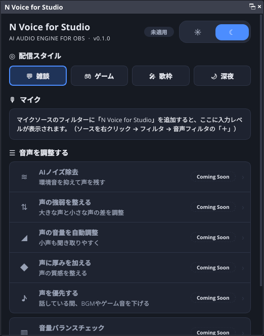
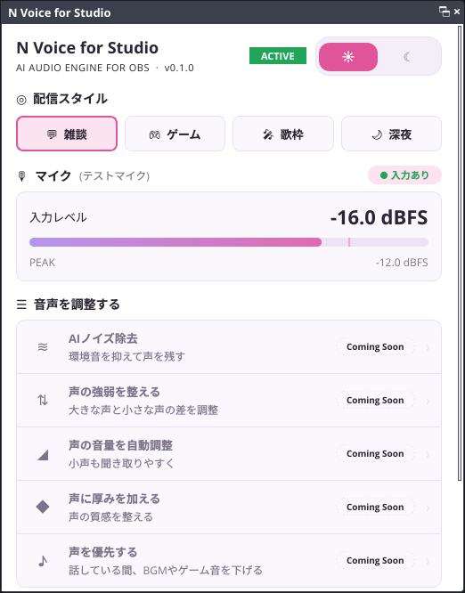

# N Voice for Studio

**AI Audio Engine for OBS** — Your Voice, Refined.

配信者向けのOBS Studio音声処理プラグインです。要件は Project の「N Voice 要件定義書 v0.2」を参照してください。

| ダーク | ライト |
|---|---|
|  |  |

## 現在の状態：Phase 1（プラグイン基盤）

| 項目 | 状態 |
|---|---|
| OBSプラグインとしてのロード | ✅ |
| 音声フィルター「N Voice for Studio」（パススルー＋入力/出力メーター） | ✅ |
| ダッシュボード（OBSドック） | ✅ |
| ダーク／ライトテーマ切替・再起動後も保持 | ✅ |
| 配信スタイル（プリセット）選択の保存 | ✅（音声への反映はPhase 2） |
| 入力レベル・ピーク表示（約30fps） | ✅ |
| 未実装機能の「Coming Soon」表示 | ✅ |
| 設定保存（JSON、バージョン・移行処理つき） | ✅ |
| OBS非依存の音声エンジン＋単体テスト | ✅ |

## ディレクトリ構成

```text
n_voice/
├── CMakeLists.txt          プラグイン本体のビルド定義（C++20）
├── CMakePresets.json       windows-x64 などのビルドプリセット
├── buildspec.json          プラグイン名・バージョン・依存（OBS 31.1.1 / Qt6）
├── engine/                 OBS非依存の音声エンジン（libobs・Qtを使わない）
│   ├── include/nvoice/engine/
│   │   ├── audio_engine.hpp      DSPチェーン＋入出力メーター
│   │   ├── level_meter.hpp       リアルタイム安全なレベルメーター
│   │   ├── processor.hpp         DSPステージ共通インターフェース
│   │   ├── parameters.hpp        全パラメーターの単位・範囲・初期値（一元管理）
│   │   └── spsc_ring_buffer.hpp  ロックフリーのリングバッファ（AI推論用）
│   └── tests/              単体テスト
├── src/
│   ├── plugin-main.cpp     モジュール読み込み・ドック登録
│   ├── obs/                音声フィルター、フィルターインスタンス管理
│   ├── config/             UI設定の保存・読み込み
│   └── ui/                 ダッシュボード、テーマ、メーター、トグル
└── data/locale/            ja-JP / en-US の表示文言
```

## ビルド手順（Windows）

### 1. 必要なもの

- **Visual Studio 2022 Build Tools**（またはVisual Studio 2022）
  - ワークロード「C++によるデスクトップ開発」
  - Windows 11 SDK（10.0.22621 以降）
- **CMake 3.28 以降**（3.30系推奨）
- **Git**
- VS Codeを使う場合は CMake Tools／C/C++ 拡張機能

### 2. ビルド

「Developer PowerShell for VS 2022」で実行します。

```powershell
cd E:\project\n_voice
cmake --preset windows-x64
cmake --build --preset windows-x64
```

初回は `buildspec.json` に従って、OBSのソースとビルド済み依存ライブラリ（Qt6など、約1GB）が自動でダウンロードされます。少し時間がかかります。

### 3. OBSへのインストール

```powershell
cmake --install build_x64 --prefix release --config RelWithDebInfo
```

`release\n-voice-for-studio` フォルダーができるので、フォルダーごと次の場所へコピーします。

```text
C:\ProgramData\obs-studio\plugins\n-voice-for-studio\
├── bin\64bit\n-voice-for-studio.dll
└── data\locale\ja-JP.ini, en-US.ini
```

### 4. 動作確認

1. OBSを起動し、メニュー「ドック」→「N Voice for Studio」でダッシュボードを表示
2. マイクのソースを右クリック →「フィルタ」→ 音声フィルタの「＋」→「N Voice for Studio」を追加
3. ダッシュボードのステータスが **ACTIVE** になり、入力レベルが動けばOK
4. テーマを切り替えてOBSを再起動し、テーマが保持されていることを確認

設定ファイルの場所：`%APPDATA%\obs-studio\plugin_config\n-voice-for-studio\settings.json`

## GitHubでの自動ビルド（GitHub Actions）

`.github/` にワークフローが入っています。GitHubへpushすると自動で実行されます。

| タイミング | 実行される内容 |
|---|---|
| `main` へのpush | 整形チェック → エンジン単体テスト（Ubuntu／Windows MSVC）→ Windows版ビルド |
| Pull Request | 上と同じ（Pull Requestでは配布用zipは作りません） |
| `0.1.0` のようなタグをpush | 上に加えて、Windows版zipを添付したReleaseの下書きを作成 |

ビルドしたプラグインは、GitHubの「Actions」タブ → 実行結果 → 「Artifacts」から `n-voice-for-studio-<版>-windows-x64-<コミット>` をダウンロードできます。

整形ルール：C++は clang-format 19.1.1、CMakeは gersemi です（どちらも設定ファイル同梱）。整形チェックで落ちたら、エラーに出ているファイルを整形してから再度pushしてください。

## 音声エンジンの単体テスト

エンジンはOBSなしで単独ビルドできます。

```powershell
cmake -S engine -B build_engine
cmake --build build_engine --config Debug
ctest --test-dir build_engine -C Debug
```

## 設計メモ

- **音声スレッドの安全性**：`filter_audio` 内では、メモリ確保・ロック・ログ出力を一切行いません。メーター値は atomic でUIスレッドへ渡します。
- **UIとフィルターの寿命**：エンジン状態を `shared_ptr` で共有し、フィルターを削除してもUIが解放済みメモリを読まない構造にしています。
- **Coming Soon**：`src/ui/dashboard_dock.cpp` の `FeatureRow::Spec` で `available` を `true` にすると、その機能が通常表示（ON/OFFトグルあり）に切り替わります。
- **パラメーター**：`engine/include/nvoice/engine/parameters.hpp` で一元管理しています。現在の範囲と初期値は暫定値で、Phase 2で調整します。

## ライセンス

GPL-2.0（OBS Plugin Template と libobs に準拠）。詳しくは `LICENSE` を参照してください。
