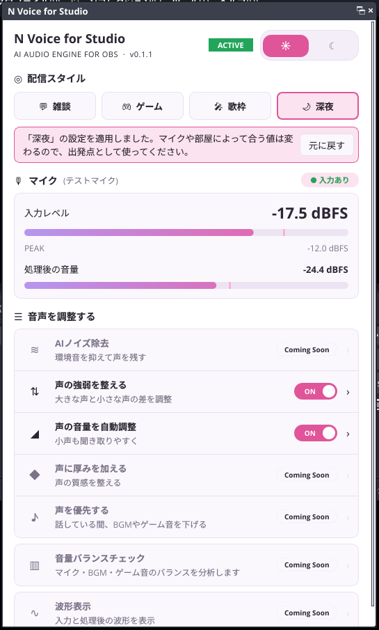
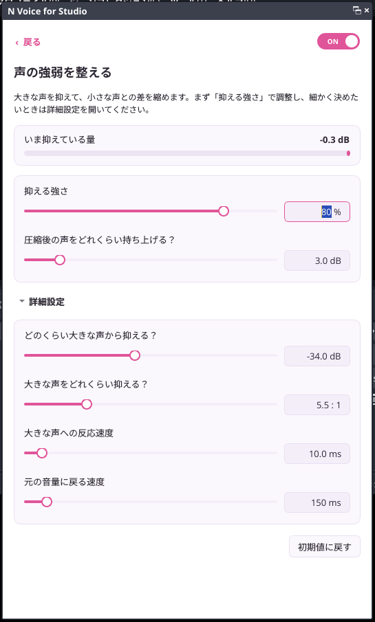

# N Voice for Studio

**AI Audio Engine for OBS** — Your Voice, Refined.

配信者向けのOBS Studio音声処理プラグインです。要件は Project の「N Voice 要件定義書」を参照してください。

| ダッシュボード | 機能の詳細画面 |
|---|---|
|  |  |

## 現在の状態：Phase 2（基本の音声処理）

| 項目 | 状態 |
|---|---|
| OBSプラグインとしてのロード（OBS 33の新しい配置） | ✅ |
| ダッシュボード（OBSドック）、ダーク／ライトテーマ | ✅ |
| 入力レベル・ピーク・処理後の音量表示（約30fps） | ✅ |
| 声の音量を自動調整（オートレベラー） | ✅ |
| 声の強弱を整える（コンプレッサー） | ✅ |
| 機能の詳細画面（スライダー＋数値入力、詳細設定、リセット、動作メーター） | ✅ |
| 配信スタイル（プリセット）の適用と「元に戻す」 | ✅ |
| 設定の保存（UIは設定ファイル、音声設定はフィルターごとにOBSが保存） | ✅ |
| 波形表示 | 未着手（Coming Soon） |
| AIノイズ除去、声に厚みを加える、声を優先する（ダッキング）、音量バランスチェック | 今後のフェーズ（Coming Soon） |

## ディレクトリ構成

```text
n_voice/
├── CMakeLists.txt          プラグイン本体のビルド定義（C++20）
├── CMakePresets.json       windows-x64 などのビルドプリセット
├── buildspec.json          プラグイン名・バージョン・依存（OBS 31.1.1 / Qt6）
├── engine/                 OBS非依存の音声エンジン（libobs・Qtを使わない）
│   ├── include/nvoice/engine/
│   │   ├── audio_engine.hpp      DSPチェーン＋入出力メーター
│   │   ├── voice_chain.hpp       処理の順番（オートレベラー → コンプレッサー）
│   │   ├── auto_leveler.hpp      声の音量を自動調整
│   │   ├── compressor.hpp        声の強弱を整える
│   │   ├── level_meter.hpp       リアルタイム安全なレベルメーター
│   │   ├── processor.hpp         DSPステージ共通インターフェース
│   │   ├── parameters.hpp        全パラメーターの単位・範囲・初期値（一元管理）
│   │   └── spsc_ring_buffer.hpp  ロックフリーのリングバッファ（AI推論用）
│   └── tests/              単体テスト
├── src/
│   ├── plugin-main.cpp     モジュール読み込み・ドック登録
│   ├── obs/                音声フィルター、フィルターインスタンス管理
│   ├── config/             UI設定の保存・読み込み
│   └── ui/                 ダッシュボード、テーマ、メーター、トグル
└── data/locale/            ja-JP / en-US の表示文言
```

## ビルド手順（Windows）

### 1. 必要なもの

- **Visual Studio 2022 Build Tools**（またはVisual Studio 2022）
  - ワークロード「C++によるデスクトップ開発」
  - Windows 11 SDK（10.0.22621 以降）
- **CMake 3.28 以降**（3.30系推奨）
- **Git**
- VS Codeを使う場合は CMake Tools／C/C++ 拡張機能

### 2. ビルド

「Developer PowerShell for VS 2022」で実行します。

```powershell
cd E:\project\n_voice
cmake --preset windows-x64
cmake --build --preset windows-x64
```

初回は `buildspec.json` に従って、OBSのソースとビルド済み依存ライブラリ（Qt6など、約1GB）が自動でダウンロードされます。少し時間がかかります。

### 3. OBSへのインストール

**対応OBS：33.0以降。** OBS 33で導入された新しいプラグイン配置（`.dll` を `data` と同じ階層に置く方式）に対応しています。OBS 32以前では読み込まれません。

```powershell
cmake --install build_x64 --prefix release --config RelWithDebInfo
.\tools\install-windows.ps1
```

インストール先（OBS 33の新方式）：

```text
C:\ProgramData\obs-studio\plugins\n-voice-for-studio\
├── n-voice-for-studio.dll
├── n-voice-for-studio.pdb
└── data\
    ├── manifest.json        プラグインマネージャー用（表示名・ID・バージョン）
    └── locale\ja-JP.ini, en-US.ini
```

旧方式の `bin\64bit\` に置くと、プラグインマネージャーで「旧方式（Legacy）」と表示され、OBS 34以降は読み込まれなくなります。

### 4. 動作確認

1. OBSを起動し、メニュー「ドック」→「N Voice for Studio」でダッシュボードを表示
2. マイクのソースを右クリック →「フィルタ」→ 音声フィルタの「＋」→「N Voice for Studio」を追加
3. ダッシュボードのステータスが **ACTIVE** になり、入力レベルが動けばOK
4. 「ツール」→「プラグインマネージャー」で、N Voice for Studio が旧方式の表示なしで、バージョン付きで並んでいればOK

設定ファイルの場所：`%APPDATA%\obs-studio\plugin_config\n-voice-for-studio\settings.json`

## 更新・リリースの流れ

### プラグインを更新する（使う側）

GitHubのReleasesかActionsからzipをダウンロードし、OBSを閉じてから実行します。

```powershell
.\tools\install-windows.ps1 -Source $HOME\Downloads\n-voice-for-studio-<版>-windows-x64.zip
```

スクリプトはプラグインフォルダーを丸ごと入れ替えます。そのため、古い版のファイルや旧方式の `bin\64bit` が残りません。設定（`%APPDATA%` 側）は消えません。

手動でやる場合は、zipの中の `n-voice-for-studio` フォルダーで `C:\ProgramData\obs-studio\plugins\n-voice-for-studio` を置き換えてください。

### 新しい版を出す（作る側）

1. `buildspec.json` の `version` を上げる（例：`0.1.1` → `0.2.0`）。プラグインマネージャーに出るバージョンも、これだけで変わります。
2. コミットして `main` にpushする。
3. 同じ番号のタグをpushする：`git tag 0.2.0` → `git push origin 0.2.0`
4. GitHub ActionsがWindows版zipを添付したReleaseの下書きを作るので、内容を確認して公開する。

## GitHubでの自動ビルド（GitHub Actions）

`.github/` にワークフローが入っています。GitHubへpushすると自動で実行されます。

| タイミング | 実行される内容 |
|---|---|
| `main` へのpush | 整形チェック → エンジン単体テスト（Ubuntu／Windows MSVC）→ Windows版ビルド |
| Pull Request | 上と同じ（Pull Requestでは配布用zipは作りません） |
| `0.1.0` のようなタグをpush | 上に加えて、Windows版zipを添付したReleaseの下書きを作成 |

ビルドしたプラグインは、GitHubの「Actions」タブ → 実行結果 → 「Artifacts」から `n-voice-for-studio-<版>-windows-x64-<コミット>` をダウンロードできます。

整形ルール：C++は clang-format 19.1.1、CMakeは gersemi です（どちらも設定ファイル同梱）。整形チェックで落ちたら、エラーに出ているファイルを整形してから再度pushしてください。

## 音声エンジンの単体テスト

エンジンはOBSなしで単独ビルドできます。

```powershell
cmake -S engine -B build_engine
cmake --build build_engine --config Debug
ctest --test-dir build_engine -C Debug
```

## 設計メモ

- **音声スレッドの安全性**：`filter_audio` 内では、メモリ確保・ロック・ログ出力を一切行いません。メーター値は atomic でUIスレッドへ渡します。
- **UIとフィルターの寿命**：エンジン状態を `shared_ptr` で共有し、フィルターを削除してもUIが解放済みメモリを読まない構造にしています。
- **Coming Soon**：`src/ui/dashboard_dock.cpp` の `FeatureRow::Spec` で `available` を `true` にすると、その機能が通常表示（ON/OFFトグルあり）に切り替わります。
- **パラメーター**：`engine/include/nvoice/engine/parameters.hpp` で、単位・範囲・初期値を一元管理しています。初心者向けの「抑える強さ」は、Threshold と Ratio をまとめて動かします（`compressorFromStrength`）。
- **処理の順番**：オートレベラー → コンプレッサー。先に話し声の音量をそろえ、残った急な大声をコンプレッサーで抑えます。
- **無音時の環境音を持ち上げない**：オートレベラーは、速い検出（50ms）で無音判定し、話していない間と話し終わりの減衰中は補正量を変えません。
- **プリセット**：`src/config/presets.cpp`。値は出発点です。適用前の設定は「元に戻す」で復元できます。

## ライセンス

GPL-2.0（OBS Plugin Template と libobs に準拠）。詳しくは `LICENSE` を参照してください。
